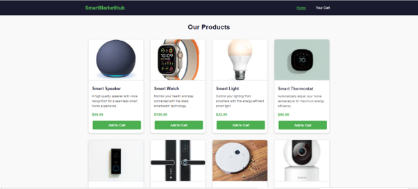
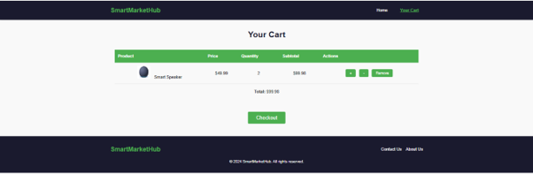
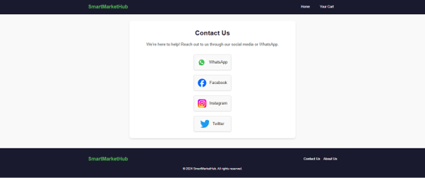
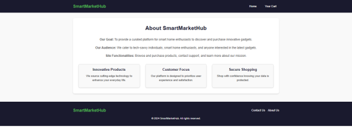
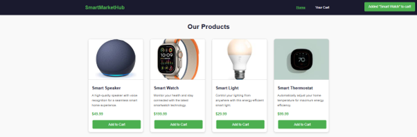

# SmartMarketHub – Smart Home E-Commerce Website

SmartMarketHub is a smart home e-commerce website developed as a group project for the Web Development course (CIT 3510) at the Faculty of Computer and Information Systems, Islamic University of Madinah.

The website provides an online storefront where users can explore smart home products, view product information, manage a shopping cart, and find contact information.

## Table of Contents

- [Project Overview](#project-overview)
- [Features](#features)
- [Technologies Used](#technologies-used)
- [Screenshots](#screenshots)
- [How to Run](#how-to-run)
- [Limitations](#limitations)

## Project Overview

SmartMarketHub is designed to showcase and sell smart home products, including smart speakers, thermostats, security cameras, and other smart gadgets.

The website provides a simple shopping experience through product browsing, cart management, and interactive notifications.

## Features

- **Product Browsing:** View available smart home products on the homepage.
- **Product Details:** Explore product information.
- **Add to Cart:** Add products to the shopping cart.
- **Shopping Cart Management:** View cart items, quantities, and prices.
- **Quantity Adjustment:** Increase or decrease product quantities.
- **Remove Items:** Remove products from the shopping cart.
- **Cart Total:** View the total price of cart items.
- **Interactive Notifications:** Receive notifications when adding products to the cart.
- **About Page:** Learn about the website's purpose, mission, target audience, and features.
- **Contact Page:** Access social media contact links, including WhatsApp, Facebook, Instagram, and Twitter.
- **Service Page:** Provides a separate page for the website's services.

## Technologies Used

- HTML
- CSS
- JavaScript
- PHP


## Screenshots

### Figure 1 – Product Display

The homepage displays the available smart home products and provides users with the option to add products to their cart.



### Figure 2 – Shopping Cart

The shopping cart displays selected products, quantities, prices, and the total amount.



### Figure 3 – Contact Page

The contact page provides social media links through which users can reach the website.



### Figure 4 – About Page

The about page introduces the website's purpose, mission, target audience, and main features.



### Figure 5 – Add to Cart Notification

An interactive notification informs users when a product is successfully added to the shopping cart.



## How to Run

1. Install a local PHP development environment such as [XAMPP](https://www.apachefriends.org/).
2. Start the Apache service.
3. Place the project folder inside the `htdocs` directory.
4. Open your browser.
5. Navigate to:

```text
http://localhost/SmartMarketHub/
```

6. Browse the products and test the available website features.

## Limitations

- The checkout button is available in the shopping cart, but the actual checkout process is not implemented.
- The project is an academic web development project and does not represent a complete production e-commerce platform.


---

*SmartMarketHub – Making Smart Home Shopping Easier.*
